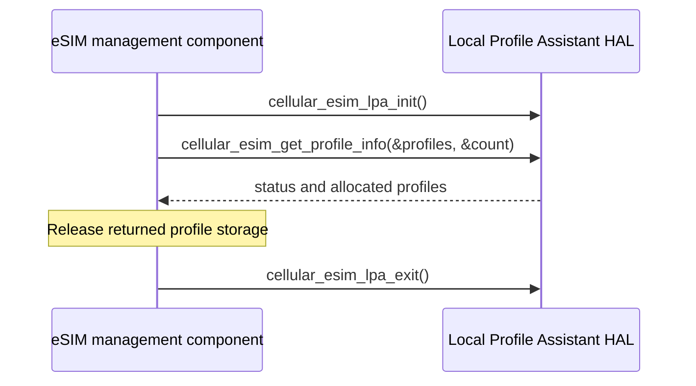

# Local Profile Assistant HAL Specification

## Version History

| Date | Comment | Version |
| --- | --- | --- |
| — | Documentation alignment; no ABI change. | — |

## Acronyms
HAL means Hardware Abstraction Layer; LPA means Local Profile Assistant; eSIM means embedded SIM; ICCID identifies a profile; EID identifies the eUICC.

## Description
The eSIM management component uses the Local Profile Assistant HAL for profile discovery, download, activation, and deletion.

## Optional Components
SM-DS discovery and default SM-DP+ download depend on platform provisioning and connectivity.

## Component Runtime Execution Requirements
### Initialization and Startup
Call `cellular_esim_lpa_init` before profile operations and `cellular_esim_lpa_exit` when finished. Check both outcomes.
### Threading Model
Serialize operations unless the vendor documents stronger guarantees.
### Process Model
The interface is an in-process boundary to the vendor LPA/modem integration.
### Memory Model
Callers own input strings and must free profile results using the implementation-compatible allocator. Respect the header's buffer capacities.
### Asynchronous Notification Model
`cellular_sim_download_progress_callback(char *progress)` reports download progress and returns `int`. Copy data needed beyond callback execution.
### Internal Error Handling
Activation-code download uses `TRUE`/`FALSE`; other operations document `RETURN_OK`/`RETURN_ERR`, while the header defines `RETURN_ERROR` as `-1`. Do not conflate Boolean success with zero success.
### Persistence Model
Profile installation and deletion change eUICC state. Plan product-approved recovery before altering profiles.

## Nonfunctional Requirements
### Logging and Debugging
Implementations must not log credentials, secrets, security-sensitive information, or other sensitive data. Log operation outcomes rather than payloads.
### Quality Control
Check return conventions per operation and restore profile state after destructive tests. Use compiler warnings, static analysis, and memory checking.
### Licensing
See repository Apache-2.0 notices.
### Build Requirements
Include `lpa_hal.h` and link the product LPA implementation and required SDK.
### Variability Management
Confirm supported download mechanisms and provisioning servers for each product.

## Interface API Documentation
| Function | Purpose and key argument/result contract |
| --- | --- |
| `cellular_esim_lpa_init` | Initialize LPA; documented status return. |
| `cellular_esim_lpa_exit` | Release LPA resources; documented status return. |
| `cellular_esim_download_profile_with_activationcode` | Activation-code string and progress callback; returns Boolean initiation status, not completion proof. |
| `cellular_esim_download_profile_from_smds` | Download using caller-supplied discovery address. |
| `cellular_esim_download_profile_from_defaultsmdp` | Download using caller-supplied default delivery address. |
| `cellular_esim_get_profile_info` | Returns allocated `eSIMProfileStruct` storage through a double pointer and count through `int *`. Caller frees returned data. |
| `cellular_esim_enable_profile` | Enable matching ICCID; header specifies a 20-digit string and size 20. |
| `cellular_esim_disable_profile` | Disable matching ICCID with the same size convention. |
| `cellular_esim_delete_profile` | Permanently delete matching ICCID with the same size convention. |
| `cellular_esim_get_eid` | Returns operation status; coordinate EID delivery with the vendor integration. |
| `cellular_esim_get_euicc` | Returns operation status; coordinate eUICC information delivery with the vendor integration. |

### Theory of Operation and Key Concepts
Initiation success does not replace progress/completion observation. Profile state values describe enabled/disabled state; progress enums alone do not define a normative state machine.

### Sequence Diagram

## Source References
- [lpa_hal.h](https://github.com/rdkcentral/rdkb-halif-lpa/blob/develop/include/lpa_hal.h)
